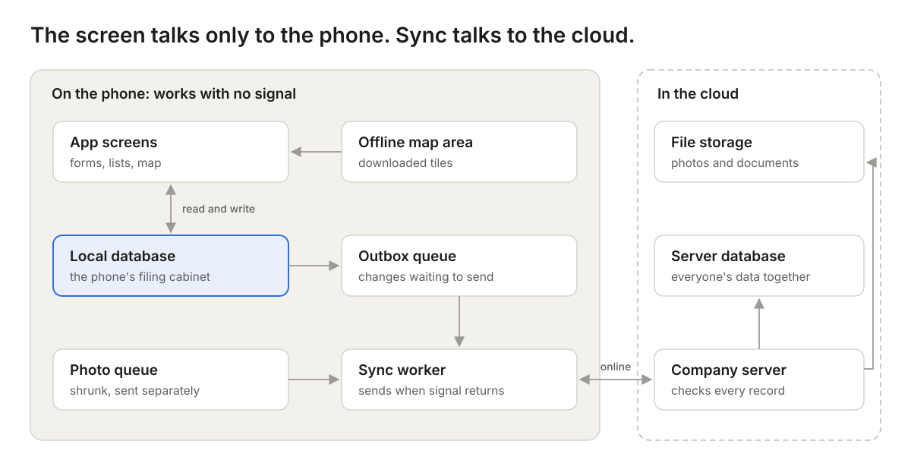

## "No signal" should never mean "no work"

Priya is a field surveyor. She spends 15 minutes in a basement shop filling in a form and taking three photos. She taps **Submit**. The screen says *Network error*. She walks upstairs, reopens the app, and the form is empty.

From that day on, Priya carries a paper notebook, just in case. The app didn't have a bug. It was built on one quiet assumption: that the internet will always be there. In basements, villages, lifts and on highways, it often isn't.

The fix is called **offline-first**: an app that works fully without internet and sends its data later. Here is how such an app works, in plain words, and the five choices every team makes when building one.

## You already use an offline-first app: WhatsApp

Type a WhatsApp message with no signal and it doesn't vanish. It sits there with a small clock icon. When signal returns, the clock turns into a tick and the message goes out by itself.

A field app should behave the same way. Two words you'll see throughout this article:

- **Server:** the company's central computer, where everyone's data ends up. Think of it as head office.
- **Sync** (short for synchronise): the phone and the server swapping updates so both hold the same information. It's the clock turning into a tick.

| Type of app | With no signal | Like |
| --- | --- | --- |
| Online-only | Nothing works | A phone call that drops |
| Offline-first | Everything works; data is sent later | A WhatsApp message with a clock icon |

## How it works, in one picture

The big idea: **the app screen never talks to the internet.** It only talks to storage inside the phone.

1. Priya saves a form. It goes into the **local database**, a filing cabinet inside the phone. That works with or without signal.
2. A copy of the change drops into the **outbox queue**, a waiting line of things to send, like the Outbox in your email.
3. The **sync worker**, a helper running in the background, watches for signal. When it finds some, it sends the waiting items to the company server, one by one.
4. Photos wait in their own line, so one big photo never holds up a form.

## Choice 1: A website-app, or an app from the store?

There are three ways to put an app on a field worker's phone:

- **PWA (Progressive Web App):** a website you can pin to your home screen. It gets an icon and can work offline, but it still runs inside the phone's web browser. Like a restaurant's menu website saved as a shortcut.
- **Native app:** downloaded from the Play Store or App Store, and built separately for Android and for iPhone. Like a tailor-made suit for each phone.
- **Cross-platform app:** also from the store, but built once and run on both kinds of phone, using tools such as React Native or Flutter. Like one good suit that fits both.

| | PWA | Cross-platform app | Native app |
| --- | --- | --- | --- |
| How users get it | Open a link | Download from store | Download from store |
| Sending out a fix | Instant | Needs store approval | Needs store approval |
| Sends data while the app is closed | Not on iPhone | Yes | Yes |
| Data kept safe on the phone | Mostly; the browser may clear it when storage runs low | Yes | Yes |
| Large offline maps | Difficult | Good | Best |
| Cost to build | Lowest | Medium | Highest (two apps) |

In short: a PWA is cheap and fast to launch, but the phone's browser, not you, decides how far it can go. On iPhones it only sends data while it's open on screen. A store app costs more, but works properly in the background.

**When to pick which:** short forms and users who usually have signal → PWA. Full days offline, lots of photos or maps → cross-platform. Special hardware such as Bluetooth measuring devices → native.

## Choice 2: Which filing cabinet inside the phone?

A database is simply an organised place to store information, like a filing cabinet with labelled drawers. An offline-first app keeps one on the phone, called a **local database**. The common options:

| Option | Think of it as | Good for | Downside |
| --- | --- | --- | --- |
| IndexedDB | A storage box built into the web browser | PWAs with simple forms | The browser may empty it to free space |
| SQLite | A sturdy filing cabinet built into every phone | Store apps with lots of data, search and filters | The team writes its own code to send data |
| Sync-ready databases (RxDB, PouchDB, WatermelonDB) | A filing cabinet that posts its own letters | Teams that want sending handled for them | Locks you into how that tool works |

**Our pick:** SQLite for store apps, IndexedDB for PWAs. Both are free, proven and widely used.

## Choice 3: How data travels, and what happens when two people disagree

Sending data is the trickiest part. Three simple rules keep it safe:

1. **The phone gives every record its own ID.** An ID is a unique code, like a receipt number. Engineers usually use a UUID, a code so random that two phones will, in practice, never make the same one. The phone doesn't have to wait for head office to number its forms.
2. **Sending twice must be harmless.** Sometimes the phone sends a form but never hears back, so it sends it again. The server sees the same ID and doesn't make a copy. Engineers call this *idempotency*. Pressing a lift button twice still brings one lift.
3. **Don't trust the phone's clock for ordering.** People set their phones to the wrong time. Keep the phone's time as "when the visit happened", but let the server stamp the official time it received each change, and use that to decide what came first.

### When two edits clash

Asha updates a shop's phone number while offline. Ravi, also offline, updates the same shop's opening hours. In the evening both phones sync. Whose version wins? This is called a **conflict**.

| Approach | How it decides | Risk |
| --- | --- | --- |
| Last change wins | The latest save replaces everything | Asha's update quietly disappears |
| Merge field by field | Phone number from Asha, hours from Ravi | Needs a rule for when both change the same field |
| Ask a person | A supervisor picks the right version | Slower |

**Our pick:** merge field by field, and ask a person only for things that really matter, like payments. Better still, design forms so clashes rarely happen: give each visit its own record ("Asha's visit on 6 Oct") instead of everyone editing the same one.

## Choice 4: Maps with no internet

A map on your phone is cut into small square pictures called **tiles**, like pieces of a jigsaw. Every time you zoom in one step, you need about four times as many pieces. That's why saving a whole city in full detail takes up so much space.

| Option | How it works | Good | Not so good |
| --- | --- | --- | --- |
| Remember what you've seen | The app keeps map pieces you've already viewed | Easiest; works in a PWA | Blank areas you never opened |
| Download packs from a map company (e.g. Mapbox, Esri) | Tap "download this area" | Polished and ready-made | Store apps only; usage or licence fees |
| Make your own map files (free tools such as MapLibre, PMTiles) | The team creates one map file per region | No fees; full control | More work for the team |

**Tip:** download only the area each worker actually covers, and only on Wi-Fi. The pins on the map, like shops and routes, come from the phone's own database, so they always work offline.

## Choice 5: Plan for real-world problems early

An app that works on office Wi-Fi can still fail on day one in the field. Plan for these from the start:

| Problem | What the user sees | The fix |
| --- | --- | --- |
| Big photos | Everything stuck behind one large photo | Shrink photos on the phone and send them in their own line |
| "Did it send?" | Workers fill in forms twice, or keep paper copies | Show a clear status on each form (Saved on phone, Sending, Sent), like WhatsApp ticks |
| App updates | A new version can't read old saved forms | Upgrade stored data carefully; never delete unsent forms |
| Wrong location | The shop pin lands on the wrong street | Save how accurate the GPS reading was, and ask to retry if it's poor |
| Lost phone | Customer data in a stranger's hands | Encrypt the app's data, and allow remote wipe |
| Login expires offline | The worker is locked out mid-day, or unsent forms are lost | Let saved work survive sign-out; ask for login again only when back online |
| Bad data arrives | Broken or tampered records reach head office | The server checks every record before accepting it; never trust the phone blindly |

## Build for the basement, not the boardroom

A good offline-first field app:

1. Saves everything on the phone first, in its own filing cabinet.
2. Sends data later by itself, through a waiting line, like WhatsApp messages.
3. Never creates duplicates, and handles clashing edits fairly.
4. Keeps maps for the worker's own area on the phone.
5. Always shows the worker what has been sent and what hasn't.

**Our view:** if your team works for hours without signal, don't rely on a PWA. Build a proper store app; cross-platform is the best value. A PWA is great for testing an idea quickly, but on iPhones the browser decides when your data is sent and how long it's kept. For field work, that's a risk you can't afford.

If Priya's app had been offline-first, her form would have been saved the moment she typed it. She would never even have noticed there was no signal. That's the goal.

---

*Building an app for teams who work where the signal doesn't reach? [Talk to the Cloud9Space team](/contact).*
