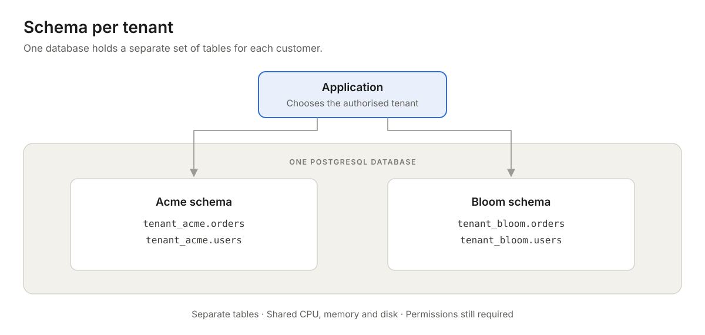
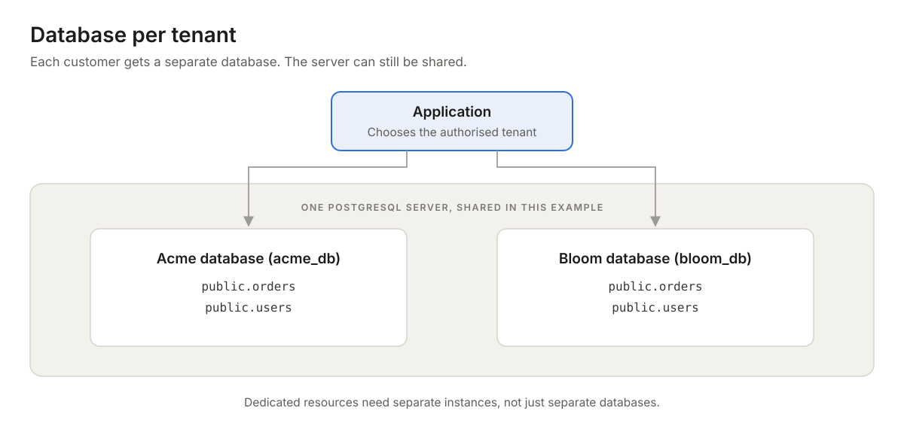
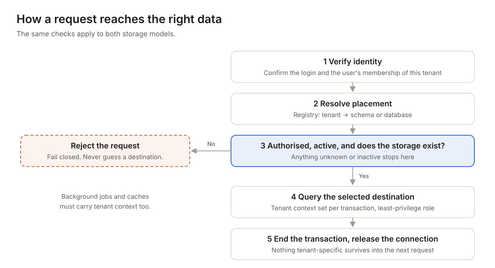

Picture an invoicing app used by two companies, Acme and Bloom. They use the same product, but neither should ever see the other's invoices. Each company is a **tenant**: a customer organisation with its own users and its own data.

**Multi-tenancy** means serving all of those customers from one shared application. The interesting question is where their data lives. **Schema-per-tenant** keeps each customer's tables in their own schema inside one database. **Database-per-tenant** gives each customer a separate database. The choice shapes your security, your costs, how upgrades go and what happens on the day you need to restore something.

## First, get the containers straight

Think of a server as an office building, a database as a room, a schema as a filing cabinet and a table as a drawer. In PostgreSQL, a schema is a named container for tables and other objects. It is not a separate server, and its name alone does not lock anyone out.

There is also a third option, the **shared schema**: every tenant uses the same tables, and a `tenant_id` column records who owns each row. That needs disciplined tenant filtering on every query, and PostgreSQL's [Row-Level Security](https://www.postgresql.org/docs/current/ddl-rowsecurity.html) can enforce it inside the database. This post focuses on the two models that give each tenant its own tables.

## Schema per tenant

Acme's invoices live in `tenant_acme.orders` and Bloom's live in `tenant_bloom.orders`. The tables usually have identical structure. Each query targets the right schema instead of mixing both companies' rows in one table.

This keeps infrastructure compact, but tenants still share CPU, memory and disk. A heavy report from Acme can slow Bloom down. That is the **noisy neighbour** problem.

## Database per tenant

Acme gets `acme_db` and Bloom gets `bloom_db`. Each has its own tables, and the application picks the right database connection for each request. In PostgreSQL a connection targets one database for its whole life; it cannot switch halfway through.

A separate database is not a separate server. Several tenant databases can sit on one server and compete for the same resources. Dedicated instances give you real resource and failure separation, although the application and other services may still be shared.

This model makes it easier to give a customer their own database credentials, or to move their data to a different instance or region. The cost is more of everything to manage: destinations, credentials, backups and upgrades. Dedicated instances also add a recurring bill per tenant.

## The practical trade-offs

| Concern | Schema per tenant | Database per tenant |
| --- | --- | --- |
| Data boundary | Separate tables; schema and table permissions matter | Separate databases; database access permissions matter |
| Resources | Shared within the database | Shared on one server; more independent on dedicated instances |
| Upgrades | Apply every change to every tenant schema | Apply every change to every tenant database |
| Reporting | Authorised queries can span schemas | Needs explicit integration or an analytics pipeline |
| Recovery | Selective export possible; restores need care | Separate logical backups; point-in-time recovery depends on deployment |

## How the app finds the right data

Keep a **tenant registry**: a directory that maps each tenant ID to its schema or database and records whether it is ready to serve traffic. Verify the login, and the user's membership of that tenant, *before* you consult the registry. A tenant ID that arrives in a URL or a header is a claim, not proof of permission.

If the tenant is unknown, inactive or unavailable, refuse the request. This is called **failing closed**. Never fall back to a default schema or database just to keep the page working. Database-per-tenant needs these checks too: a routing bug can still hand one customer another customer's connection.

## Routing is not access control

Choosing a schema tells PostgreSQL where to look. Database permissions decide what the connection is actually allowed to touch. If one application role can read every schema, a single bad query can still cross tenant boundaries. Give each code path the least access it needs ([schemas and privileges](https://www.postgresql.org/docs/current/ddl-schemas.html)).

**Watch reused connections.** A connection pool keeps database connections open for reuse. With schema routing, set the tenant context for every transaction. PostgreSQL's `search_path` decides where unqualified table names resolve, and `SET LOCAL` limits that setting to the current transaction, so it disappears when the transaction ends. Test rollbacks, retries and connection reuse explicitly; that is where leaks hide.

**Know what your query library rewrites.** SQLAlchemy can rewrite schema names using [`schema_translate_map`](https://docs.sqlalchemy.org/en/20/core/connections.html#translation-of-schema-names). It applies to queries SQLAlchemy generates, but not to handwritten `text()` SQL. Configure it consistently for the whole tenant session; a mapping attached to a single acquired connection can be lost after a rollback. And never treat string replacement as a security boundary.

## The work around the database

**Onboarding.** Register the tenant as *provisioning*, create its storage, apply the current table structure and permissions, then mark it *active*. Make every step safe to retry: check that existing resources are correct rather than blindly recreating them. Keep half-built tenants out of normal traffic.

**Migrations.** A migration is a versioned change, such as adding a column to invoices. Both models repeat that change once per tenant. Track each tenant's version, roll out in small batches and record failures. Keep the application compatible with both the old and new version while the rollout runs. Creating missing tables alone does not upgrade the ones that already exist.

**Connections.** Database-per-tenant needs connections aimed at each database, usually through separate pools, and the numbers add up quickly. 200 active tenant pools × 10 connections × 4 application processes allows up to 8,000 connections before any overflow. That is a ceiling, not what sits idle, but PostgreSQL ships with a default of around 100 connections, so you will need bounded pools, idle-pool cleanup, limits on parallel queries and usually a pooler such as PgBouncer.

**Recovery.** A backup is a saved copy; a restore is the tested process of making it usable again. PostgreSQL can export one schema with [`pg_dump --schema`](https://www.postgresql.org/docs/current/app-pgdump.html), but objects it depends on outside that schema may need separate handling. A separate database gets its own clean logical dump, which keeps the boundary simple.

Point-in-time recovery is the catch. Standard PostgreSQL [point-in-time recovery](https://www.postgresql.org/docs/current/continuous-archiving.html), rewinding to a chosen moment, restores the whole cluster: every database run by that server instance. Separate databases on a shared instance do not get independent point-in-time recovery. You may need to restore elsewhere and extract the one tenant, or use a dedicated instance or your cloud provider's equivalent feature.

**Everything else.** Put the tenant into cache keys, file paths, background jobs and logs. Perfect database isolation will not stop a shared cache from serving one customer another customer's response. Test tenant A and tenant B side by side, including failed requests and retries.

## How to choose

Choose **schema-per-tenant** when separate tables are useful, shared infrastructure is acceptable and your team can automate schema changes reliably. Choose **database-per-tenant** when customers need their own database access, data placement or operational treatment. If they need dedicated resources, plan for separate instances as well.

There is no universal tenant count where one model wins. Estimate tenants × tables × indexes, then test realistic traffic, migration time, connection use and recovery. Lots of small tenants may suit shared tables with Row-Level Security, as long as the policies are carefully scoped and the application role cannot bypass them.

A **hybrid** is common: ordinary tenants on shared infrastructure, selected customers on dedicated databases. Store each tenant's placement in the registry, and treat moving a tenant as a migration in its own right: copy and validate the data, handle writes during the switch, change the routing and keep a rollback plan.

In the end, pick the model your team can operate reliably. Before launch, prove three things: one tenant cannot read another's data, every tenant can receive an upgrade, and any single customer's data can be recovered when it matters.

## Further reading

- [PostgreSQL: Schemas and privileges](https://www.postgresql.org/docs/current/ddl-schemas.html)
- [PostgreSQL: Row Security Policies](https://www.postgresql.org/docs/current/ddl-rowsecurity.html)
- [SQLAlchemy: Translation of schema names](https://docs.sqlalchemy.org/en/20/core/connections.html#translation-of-schema-names)
- [PostgreSQL: pg_dump](https://www.postgresql.org/docs/current/app-pgdump.html)
- [PostgreSQL: Continuous archiving and point-in-time recovery](https://www.postgresql.org/docs/current/continuous-archiving.html)

---

*Designing a multi-tenant platform and weighing these trade-offs? [Talk to the Cloud9Space team](/contact).*
