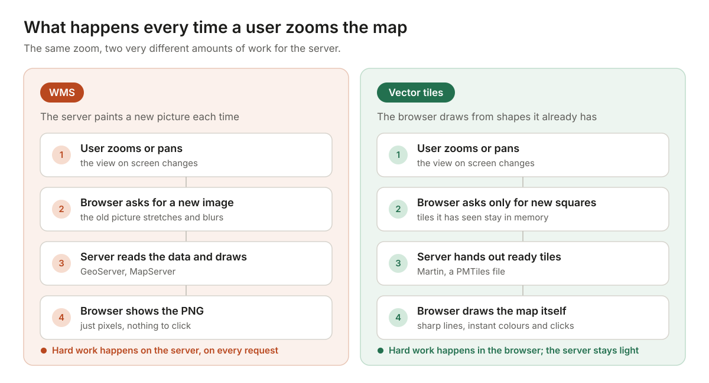

## "Why is the map so slow?"

Rahul runs operations for a delivery company. Every morning he opens a web dashboard that shows 8,000 delivery points on a city map. He drags the map to look at the east side of town.

For two seconds, nothing. Then grey squares. Then the map pops in, one block at a time. He zooms in. The points look blurry, then snap into place. He clicks a point to see the order details, and waits again.

Meanwhile, the server team is worried. Every drag and every zoom asks the map server to draw a new picture. With 40 people using the dashboard, the server spends all day painting images.

None of this is a bug. It's an architecture choice made on day one: how the map gets from the server to the screen. There are two main ways to do it, **WMS** and **vector tiles**. This article explains both in plain words, compares them side by side, and ends with a simple rule for picking one.

## The two ideas, explained with a cake and a recipe

Imagine you want a cake at home.

**Option 1:** you order a finished cake from a bakery. It arrives ready. You can't change the icing colour, and if you want a different size, you order a new cake. This is **WMS (Web Map Service)**. The server draws the map and sends you a finished picture, a PNG or JPEG image.

**Option 2:** the shop sends you the ingredients and a recipe. You bake it yourself, in any colour or shape you like, and you can change it any time. This is **vector tiles**. The server sends the raw shapes (points, lines, areas) plus their details, and the browser draws the map itself.

| Approach | What the server sends | Feels like |
| --- | --- | --- |
| WMS | A finished image of the map | Ordering a ready-made cake |
| Vector tiles | Shapes and data, in small square pieces | Getting the ingredients and the recipe |

One more word you'll hear: **tiles**. A web map is usually cut into small squares, like a chessboard, and the browser only loads the squares you can see. Vector tiles are always cut this way. WMS, by design, draws one picture for whatever area you ask for. Many map libraries request WMS in tile-sized chunks anyway, but the server still draws every one of them fresh. (There is also a properly tiled cousin of WMS called WMTS, which we cover later.)

## The blueprint in one picture

Both approaches usually start from the same data, often a spatial database such as PostGIS. The difference is who does the drawing: the server or the browser.

With WMS, the hard work happens on the server, every time someone moves the map. With vector tiles, the server mostly hands out ready-made pieces, and the user's device does the drawing. That one difference explains almost every pro and con below.

## Decision 1: How fresh does your data need to be?

**WMS is always live.** Because the server draws a new picture for every request, it reads straight from your database. If a record is added at 10:01, the map shows it at 10:01 (unless you've put a cache in front of it).

**Vector tiles are often pre-built.** Many teams generate tiles ahead of time with a tool like Tippecanoe and save them as files, for example a single PMTiles file. These are very fast and cheap to host, but when the data changes, you have to rebuild them.

There is a middle path: **live vector tile servers** such as Martin or pg_tileserv. They make vector tiles straight from PostGIS when they're requested, so the data stays fresh.

| Your data | Good fit | Why |
| --- | --- | --- |
| Changes rarely (borders, roads, land parcels) | Pre-built vector tiles | Build once, serve millions of times for almost nothing |
| Changes every few minutes (deliveries, assets, field visits) | Live vector tile server, or WMS | Each request reads the latest data |
| Changes every second (live vehicle tracking) | Neither alone; send live points as GeoJSON on top | Tiles of any kind are too slow to rebuild every second |

## Decision 2: How should the map feel to use?

This is where users notice the difference most.

**With WMS**, every pan or zoom sends a new request and waits for a new image. While you zoom, the old picture is stretched and looks blurry until the new one arrives. Labels can get cut off at the edges of images. Rotating or tilting the map isn't really possible.

**With vector tiles**, zooming is smooth, because the browser simply redraws the shapes at the new size. Lines stay sharp on any screen. The browser places labels across the whole view, so they don't get chopped at tile edges and stay upright when you rotate. You can rotate and tilt the map, and even show 3D buildings.

**The catch:** vector tiles make the user's device work harder. On a very old phone, or a cheap office laptop showing a huge, dense layer, the browser can slow down. A WMS picture is light for the device, because it's just an image.

## Decision 3: Do you need to change colours or click on things?

**Styling.** In WMS, the look of the map is set on the server, often with a style file called SLD. Want a dark mode, or shops coloured by sales? The server has to draw new pictures. With vector tiles, the style lives in the browser. You can switch to dark mode, highlight one category or hide a layer instantly, with no new request to the server.

**Clicking and hovering.** A WMS image is just pixels; the browser doesn't know there's a shop at that spot. To show details when someone clicks, the app has to send another request to the server (called GetFeatureInfo) and wait. With vector tiles, the shape and its details are already in the browser, so hover effects, pop-ups and filters happen at once.

For Rahul's dashboard, this matters a lot: "show only late deliveries" becomes a quick filter in the browser instead of another trip to the server.

## Decision 4: What kind of data are you showing?

Not all map data is made of shapes.

- **Points, lines and areas** (shops, roads, pipelines, plots of land): vector tiles shine here.
- **Pictures of the ground** (satellite photos, drone images, scanned old maps): these are already images, so an image service like WMS or WMTS is the natural fit.
- **Grid data** (elevation, rainfall, temperature, heat maps from models): usually best drawn on the server as images too.
- **Very heavy, detailed shapes** (millions of parcels at country level): vector tiles can handle it, but only with careful simplification at low zoom levels. WMS handles it more simply, because the server just draws the result.

## Decision 5: Standards, tools and security

**WMS is the older, official standard.** It comes from the Open Geospatial Consortium (OGC) and has been around for over 20 years. Almost every GIS tool speaks it: QGIS, ArcGIS, GeoServer, MapServer, OpenLayers, Leaflet. Many governments and agencies publish their data as WMS. If you need to share layers with other organisations, WMS is the safe common language.

**Vector tiles are newer, but now widely used.** Most use the Mapbox Vector Tile (MVT) format, and the OGC's newer standard, OGC API – Tiles, covers them too. Web libraries such as MapLibre and OpenLayers display them well, and GeoServer can serve them as well.

**Security is the point people forget.** With vector tiles, the real shapes and their details are sent to the browser. A curious user can open the browser's developer tools and copy them. With WMS, users receive a picture. So if your data is sensitive (customer homes, private assets), keep the secret fields out of the tiles, or serve that layer as WMS.

WMS isn't automatically safe either. GetFeatureInfo hands back the details behind any pixel, and map servers often expose the same layer through other services that return raw data. Switch off what you don't use, limit which fields are returned, and put every map and tile URL behind the same login as the rest of your app.

## The full comparison

| | WMS | Vector tiles |
| --- | --- | --- |
| Who draws the map | The server | The browser |
| What travels over the network | Images (PNG, JPEG) | Shapes and data (small, compressed) |
| Zoom and pan feel | Steps, blur while loading | Smooth and sharp |
| Changing colours / dark mode | Server must redraw | Instant in the browser |
| Click for details | Extra request to the server | Instant; the data is already there |
| Fresh data | Always live | Pre-built (rebuild needed), or live with a tile server |
| Server load | High; it draws every request | Low; mostly hands out files |
| Device load | Light | Heavier; needs a decent device |
| Satellite and grid data | Great fit | Not meant for it |
| Sharing with other GIS tools | Universal standard | Good and growing |
| Hiding raw data from users | Mostly; only pixels are sent, if feature info is locked down | No; the shapes are sent |

## What about WMTS?

**WMTS (Web Map Tile Service)** is the tiled cousin of WMS. The server still draws images, but it cuts them into fixed squares and saves them in a cache, often with GeoWebCache. The next user gets the saved square instantly. It fixes most of WMS's speed problems for data that doesn't change often, but you still get images, so no instant restyling or clicking.

## The honest answer: most good maps use both

You don't have to pick only one. Modern web maps usually stack layers, like sheets of glass on top of each other:

1. **Bottom layer: the background map.** Vector tiles for streets and labels, or a satellite image as WMTS.
2. **Middle layer: your own business data.** Vector tiles, so users can filter, colour and click.
3. **Extra layers from others.** A government flood-zone or land-use map that's only offered as WMS. Just add it on top.
4. **Top layer: live data.** Moving vehicles or new records, sent as plain GeoJSON and refreshed every few seconds.

MapLibre and OpenLayers can mix all of these in a single map.

## Let the user's screen do the drawing, when it can

The choice comes down to five questions:

1. **Freshness:** does the data change all the time? WMS or a live vector tile server. Rarely? Pre-built vector tiles.
2. **Feel:** do users zoom and pan a lot? Vector tiles feel much smoother.
3. **Interaction:** do users filter, restyle or click features? Vector tiles.
4. **Data type:** satellite images or grids? WMS or WMTS.
5. **Sharing and security:** need to share with other GIS tools, or keep raw data hidden? WMS.

**Our view:** for a new web app that people use every day, make vector tiles the default for your own data, and add WMS only for imagery, outside data sources or sensitive layers. WMS isn't old or wrong; it's still the best common language between GIS systems. But for a smooth, modern map in the browser, vector tiles win most of the time.

Rahul's dashboard didn't need a bigger server. It needed the map to arrive as ingredients, not as a finished cake. With vector tiles, his "late deliveries only" filter would take a blink, not a wait.

---

*Planning a map-heavy product, or untangling a slow one? [Talk to the Cloud9Space team](/contact).*
